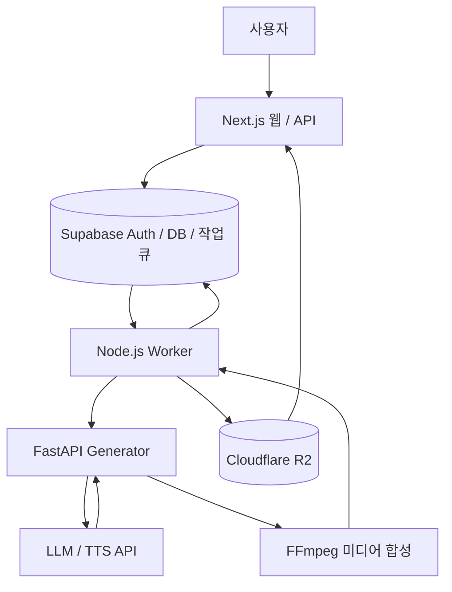

# Kiricast


**캐릭터와 함께 이야기를 이어 가는 AI 숏폼 오디오 드라마 서비스**

이야기 아이디어와 캐릭터를 바탕으로 시리즈를 만들고, 대본과 음성을 생성합니다. 에피소드가 끝나면 이야기 요약과 캐릭터 상태를 갱신하고, 사용자가 선택한 방향으로 다음 화를 이어 갑니다.

[주요 기능](#주요-기능) · [아키텍처](#아키텍처) · [시작하기](#시작하기) · [개발 가이드](docs/DEVELOPMENT.md) · [검증 기록](VALIDATION.md)

## 주요 기능

- **시리즈 만들기** — 세계관, 캐릭터, 주요 갈등과 장기 전개를 설정하고 편집합니다.
- **이야기 이어 쓰기** — 시리즈 설정과 이전 이야기의 기억을 조합해 다음 에피소드의 시나리오와 대본을 생성합니다.
- **캐릭터별 음성 합성** — 대사, 내레이션, 효과음을 처리하고 FFmpeg로 하나의 오디오로 합칩니다.
- **다음 화 선택** — 생성된 이야기를 바탕으로 다음 전개 후보를 제시합니다.
- **클립 감상** — 피드에서 오디오 클립과 자막을 확인하고, 캐릭터 구독과 좋아요를 이용합니다.

## 기술 스택

| 구분 | 기술 |
| --- | --- |
| 웹 | Next.js 16, React 19, TypeScript, Tailwind CSS 4 |
| 생성 서버 | Python, FastAPI |
| 작업 처리 | Node.js worker, Supabase 기반 작업 큐 |
| 인증·데이터 | Supabase Auth, PostgreSQL |
| 미디어 저장 | Cloudflare R2 |
| AI | Anthropic, OpenAI, ElevenLabs, Gemini |
| 미디어 처리 | FFmpeg, Pillow |

## 아키텍처



웹 요청과 시간이 오래 걸리는 생성 작업을 분리했습니다. Worker는 큐에서 작업을 가져와 Generator를 호출하고, 생성된 미디어를 R2에 저장한 뒤 클립 정보와 작업 상태를 갱신합니다.

### 이야기 생성 엔진

장기 설정과 에피소드마다 변하는 정보를 분리해 다음 생성에 필요한 맥락을 구성합니다.

| 구성 요소 | 역할 |
| --- | --- |
| 시리즈·아크 문서 | 세계관, 캐릭터, 갈등과 장기 전개의 기준 |
| 에피소드·롤링 요약 | 각 화의 기록과 이전 이야기의 압축된 맥락 |
| 핵심 기억 | 주요 사건, 공개된 비밀, 관계, 미해결 실마리와 복선 |
| 캐릭터 상태(FSM) | 감정 상태를 수치로 관리하고 한 번의 변화 폭을 제한 |
| 시나리오·대본 생성 | 기억과 상태를 참조해 사건을 구성하고 대사로 구체화 |

시나리오 생성에는 롤링 요약을 우선 사용하며, 없으면 최근 3개 에피소드 요약을 사용합니다. 롤링 요약은 500자 이내로 저장하고, 캐릭터 상태는 변화량을 ±1, 상태 값을 1~5로 제한합니다. 에피소드 생성 후 갱신된 요약·기억·상태는 다음 화의 입력으로 이어집니다.

핵심 구현은 [`podcast_maker.py`](podcast_maker.py), 결과 저장과 시리즈 갱신은 [`worker.mjs`](web/scripts/worker.mjs)에서 확인할 수 있습니다.

## 시작하기

### 요구 사항

- Node.js 20.9 이상, npm, Python 3.12 권장
- FFmpeg 및 ffprobe
- 개발용 Supabase 프로젝트와 R2 버킷
- 사용할 LLM·TTS 공급자의 API 키

> 이 저장소는 2026-03-06 기준 소스입니다. 기본 DB 테이블·일부 RPC 정의가 누락되어 있어 복원이 필요하며, 외부 배포 전 기존 권한 검사를 보완해야 합니다. 아래 명령을 실행하기 전에 [DB 준비와 배포 제한](docs/DEVELOPMENT.md#데이터베이스-준비)을 확인하세요.

### 1. 저장소와 환경 변수 준비

```bash
git clone https://github.com/Dav3411/kiricast.git
cd kiricast
cp web/.env.example web/.env.local
```

`web/.env.local`에 개발용 Supabase, R2, AI API 값을 입력합니다. 서버 전용 비밀키를 `NEXT_PUBLIC_*` 변수에 넣지 마세요. 전체 항목은 [환경 설정 가이드](docs/DEVELOPMENT.md#환경-변수)에 정리했습니다.

### 2. 웹 실행

```bash
cd web
npm ci
npm run dev
```

브라우저에서 <http://localhost:3000>으로 접속합니다.

### 3. Generator 실행

저장소 루트에서 새 터미널을 열어 실행합니다.

```bash
python3 -m venv .venv
.venv/bin/python -m pip install -r requirements.txt
.venv/bin/python -m uvicorn local_server:app --host 127.0.0.1 --port 8787
```

### 4. Worker 실행

DB와 R2 준비가 끝나면 저장소 루트에서 새 터미널을 열어 실행합니다.

```bash
cd web
npm run worker:run
```

위 예시는 macOS/Linux 기준입니다. [Windows PowerShell 명령](docs/DEVELOPMENT.md#windows-powershell)과 [외부 API 비용 및 실행 주의 사항](docs/DEVELOPMENT.md#외부-서비스와-비용)도 확인하세요.

## 프로젝트 구조

```text
kiricast/
├── web/
│   ├── src/app/          # 페이지와 API: 시리즈, 캐릭터, 클립
│   ├── scripts/worker.mjs
│   ├── sql/              # 증분 SQL 자료
│   └── .env.example
├── local_server.py       # FastAPI 생성 서버
├── podcast_maker.py      # 이야기·기억·음성·미디어 생성
├── agents.json           # 예제 캐릭터 설정
├── requirements.txt
├── docs/DEVELOPMENT.md
└── VALIDATION.md
```

## 문서

- [개발 가이드](docs/DEVELOPMENT.md) — 환경 변수, DB 준비, Windows 실행, 폰트와 배포 제한
- [검증 기록](VALIDATION.md) — 타입·문법 검사와 웹 빌드 결과, 실제 실행 검증 범위

## 개발 정보

- **개발 기간:** 6개월 · 2인 팀
- **최성원:** 서비스 기획, 프론트엔드·백엔드 전반 구현 및 시스템 구성
- **연락처:** [GitHub](https://github.com/Dav3411) · [이메일](mailto:davdev3411@gmail.com)

## 라이선스

이 저장소에는 별도 오픈소스 라이선스를 부여하지 않았습니다. 의존 패키지는 각각의 라이선스를 따릅니다. 코드와 미디어의 이용·재배포 관련 사항은 [권리 안내](docs/DEVELOPMENT.md#라이선스와-미디어)를 확인하세요.
